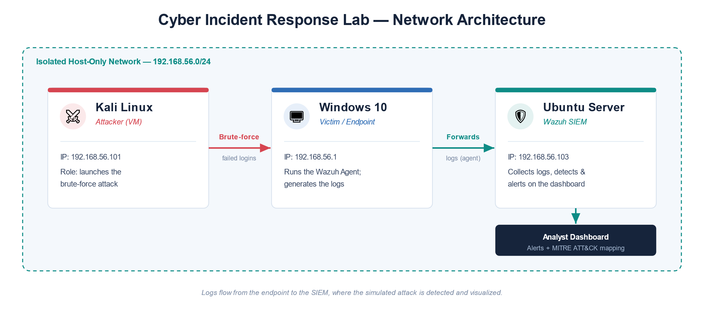
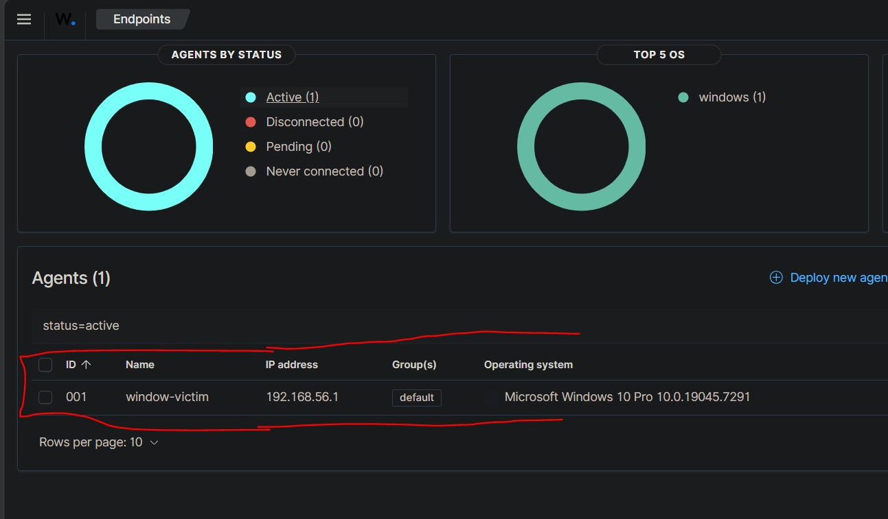
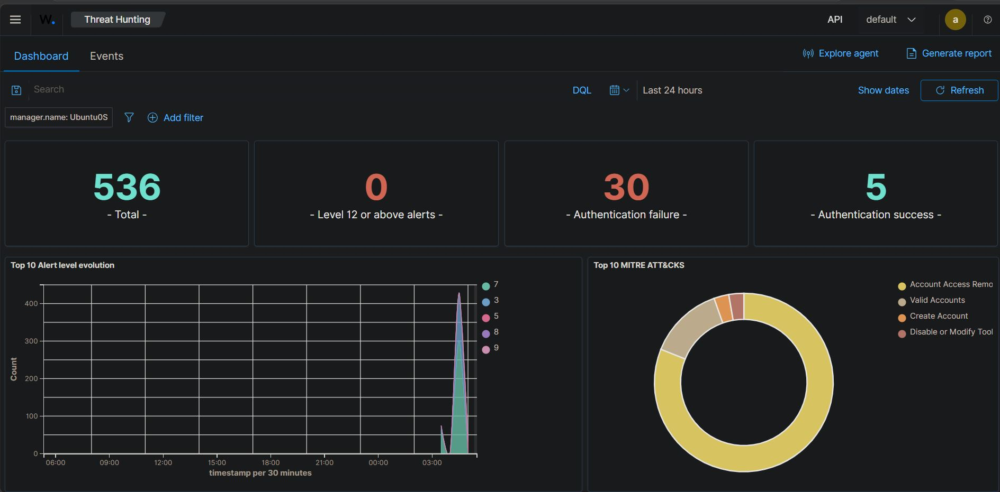
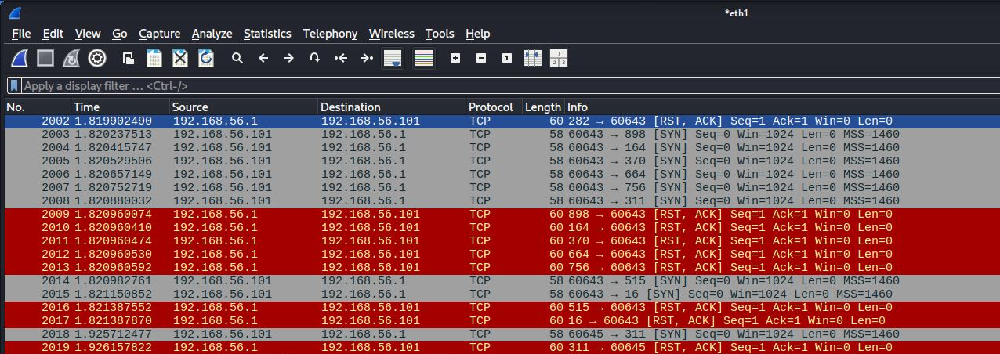
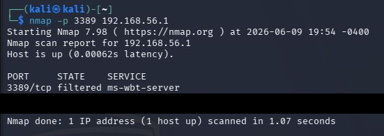

# CIRS: Cyber Incident Response System

A hands-on incident response lab built in an isolated virtual network. A **Wazuh SIEM** collects and correlates logs from a monitored Windows endpoint, **Kali Linux** simulates attacks against it, and **Wireshark** confirms each detection at packet level. The lab follows the SANS PICERL incident response lifecycle from preparation through lessons learned.

Capstone project, BS Cybersecurity, University of Management and Technology (UMT), Lahore.



## **1. Lab Architecture**

All machines run in VirtualBox on an isolated host-only network (`192.168.56.0/24`), so no attack traffic leaves the lab.

| Machine | Role | Lab IP |
|---|---|---|
| Ubuntu Server | Wazuh manager, indexer and dashboard | 192.168.56.103 |
| Windows 10 | Victim endpoint running the Wazuh agent | 192.168.56.1 |
| Kali Linux | Attacker | 192.168.56.101 |

## **2. Tools**

| Component | Tool |
|---|---|
| SIEM | Wazuh (all-in-one) |
| Packet analysis | Wireshark |
| Attacker | Kali Linux, Nmap, brute-force wordlist attack |
| Virtualization | VirtualBox |
| Framework | SANS PICERL, NIST SP 800-61 |

## **3. Attack Scenarios and Results**

| Attack | Detected by SIEM | Confirmed in Wireshark | Response |
|---|---|---|---|
| Port scan (reconnaissance) | Connection spike | SYN burst with RST replies | Logged and alerted |
| Credential brute force | High-severity alert, MITRE ATT&CK mapped | Repeated login attempts | Attacker auto-blocked by active response |

## **4. Screenshots**

**Wazuh agent registered and active**



**Threat hunting dashboard: authentication failures and MITRE ATT&CK techniques**



**Wireshark capture of the port scan**



**Nmap reconnaissance from Kali**



## **5. Incident Response Lifecycle**

1. **Preparation:** isolated network, static IPs, clean VM snapshots, Wazuh deployed
2. **Identification:** Wazuh correlates failed logins and connection spikes into severity-rated alerts
3. **Containment:** active-response rule automatically firewalls the attacking IP
4. **Eradication:** compromised test account disabled, test artifacts removed
5. **Recovery:** endpoint restored from a clean snapshot and re-verified
6. **Lessons learned:** strong password policy, MFA, login rate limiting, network segmentation

## **6. Reproduce the Lab**

```bash
# Ubuntu server: Wazuh all-in-one install
curl -sO https://packages.wazuh.com/4.x/wazuh-install.sh
sudo bash ./wazuh-install.sh -a
```

1. Install the Wazuh agent on the Windows endpoint and register it with the manager IP.
2. Start a Wireshark capture on the endpoint's host-only interface.
3. From Kali, run reconnaissance (`nmap`) and a credential brute-force attack against the endpoint.
4. Review alerts in Wazuh Threat Hunting, confirm in Wireshark, then enable an active-response rule and repeat the attack to see the attacker blocked.

Only run these attacks against machines you own, inside an isolated network.

## **7. Full Report**

The complete technical write-up is in [`docs/report.md`](docs/report.md).
