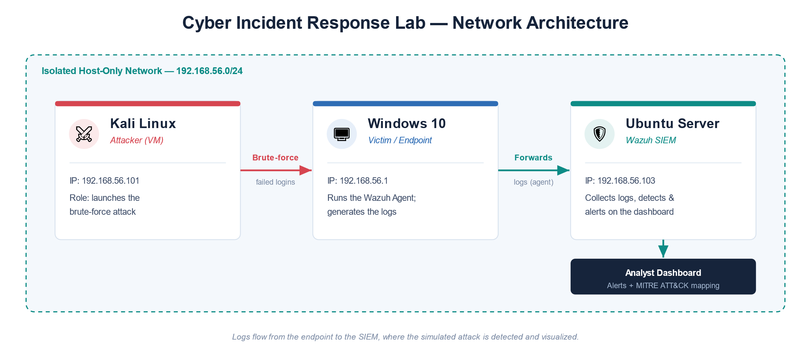
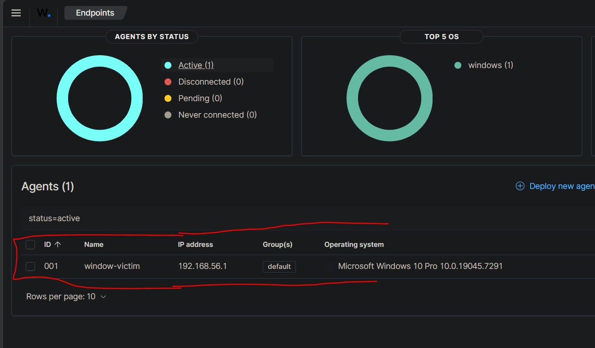
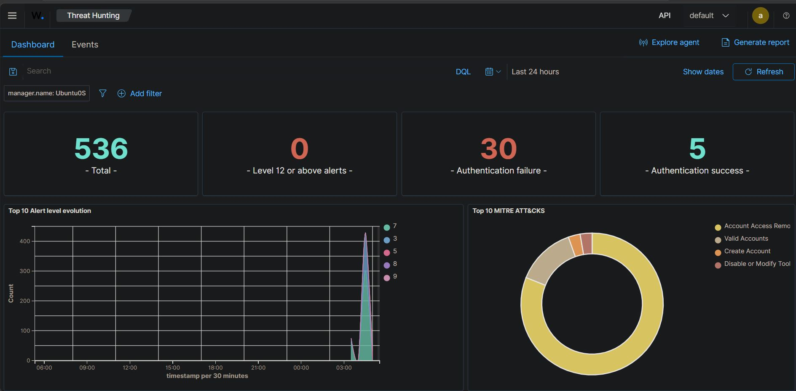
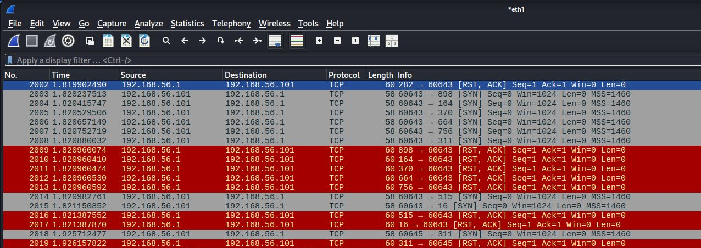
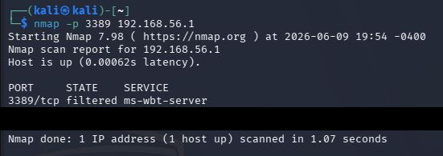

# Cyber Incident Response System: Project Report

## Abstract

Cyberattacks against organizations are growing in both frequency and sophistication, making the ability to detect and respond to security incidents a critical capability. This project presents the design and implementation of a Cyber Incident Response System built within an isolated virtual laboratory. The system integrates three core components: a Security Information and Event Management (SIEM) platform for centralized log collection and correlation, the Wireshark protocol analyzer for packet-level investigation, and structured system and network logs as the underlying source of evidence.

The implementation follows the six-phase SANS incident response lifecycle (Preparation, Identification, Containment, Eradication, Recovery, and Lessons Learned). Controlled attacks, including network reconnaissance and an SSH brute-force attempt, were simulated against a monitored endpoint. The SIEM successfully detected the malicious activity and generated severity-rated alerts, packet captures in Wireshark confirmed the nature of the traffic, and an automated active-response rule blocked the attacking host. The project demonstrates that a layered, evidence-driven response system substantially reduces the time an attacker remains undetected and provides defensible forensic records for post-incident analysis.

**Keywords:** Incident Response, SIEM, Wireshark, Log Analysis, Threat Detection, Network Security, SANS PICERL.

## 1. Introduction

### 1.1 Background

Modern information systems generate vast quantities of activity data across servers, network devices, and applications. Hidden within this data are the early signatures of cyberattacks. Incident Response (IR) is the structured, repeatable process an organization follows to detect, investigate, contain, and recover from such attacks while preserving evidence and learning from each event. Without a defined system, security teams respond in an ad-hoc manner, alerts are missed, and adversaries can remain inside a network undetected for extended periods.

### 1.2 Problem Statement

Many organizations collect logs but lack the tooling to correlate them into meaningful alerts, to confirm suspected incidents at a technical level, and to respond in a timely and consistent way. There is a need for an integrated system that unifies detection, investigation, and response into a single workflow that can be demonstrated and measured.

### 1.3 Objectives

The objectives of this project are as follows:

1.  To design an isolated laboratory environment suitable for safely simulating and analyzing cyber incidents.

2.  To deploy a SIEM platform that centralizes log collection and applies correlation rules to detect malicious activity.

3.  To use Wireshark for packet-level investigation that confirms and characterizes detected threats.

4.  To implement an automated response mechanism that contains an active attack.

5.  To document the full incident lifecycle in line with an industry-standard framework.

### 1.4 Scope and Limitations

The project is implemented entirely within a virtualized, internal-only network using systems owned by the author. All offensive tools are directed solely at these laboratory machines for educational purposes. The system is a proof-of-concept intended to demonstrate detection and response principles; it is not hardened for production deployment, and the data volumes involved are small relative to an enterprise environment.

## 2. Background and Framework

The system is structured around the SANS incident response lifecycle, often abbreviated PICERL, which complements the widely referenced NIST Special Publication 800-61 guidance on computer security incident handling. The six phases are summarized below.

| **Phase**           | **Description**                                                                     |
|---------------------|-------------------------------------------------------------------------------------|
| **Preparation**     | Establishing tools, monitoring, playbooks, and baselines before an incident occurs. |
| **Identification**  | Detecting and confirming that a security incident is actually taking place.         |
| **Containment**     | Limiting the scope and spread of the incident, e.g., isolating affected hosts.      |
| **Eradication**     | Removing the root cause: malware, unauthorized accounts, and attacker footholds.    |
| **Recovery**        | Restoring affected systems to a known-good state and verifying integrity.           |
| **Lessons Learned** | Documenting the incident and improving defenses to prevent recurrence.              |

## 3. Tools and Technologies

The following tools and technologies were used to build and operate the system.

| **Component**       | **Tool**                   | **Role in the System**                                                        |
|---------------------|----------------------------|-------------------------------------------------------------------------------|
| **SIEM**            | Wazuh                      | Centralized collection, correlation, alerting, and automated active response. |
| **Packet Analyzer** | Wireshark                  | Deep, packet-level inspection of captured network traffic.                    |
| **Endpoint OS**     | Ubuntu / Windows           | Monitored victim host running the SIEM agent and generating logs.             |
| **Attacker OS**     | Kali Linux                 | Source of simulated reconnaissance and credential attacks.                    |
| **Virtualization**  | VirtualBox                 | Hosts the isolated internal-only laboratory network.                          |
| **Log Sources**     | auth.log, syslog, firewall | Raw evidence of authentication, system, and network events.                   |

## 4. System Architecture

The laboratory consists of three virtual machines connected on a single isolated internal network. The endpoint runs a lightweight SIEM agent that forwards its logs to the SIEM server. The attacker machine generates malicious traffic toward the endpoint, while Wireshark captures that traffic for forensic analysis. The SIEM server analyzes incoming logs, raises alerts, and can issue automated responses back to the endpoint.

| **Virtual Machine**   | **IP Address (example)** | **Function**                                  |
|-----------------------|--------------------------|-----------------------------------------------|
| **SIEM Server**       | 192.168.56.10            | Wazuh manager, indexer, and dashboard.        |
| **Endpoint (Victim)** | 192.168.56.20            | Monitored host; runs the agent and Wireshark. |
| **Attacker**          | 192.168.56.30            | Kali Linux; launches simulated attacks.       |

## 5. Implementation

### 5.1 Laboratory Setup (Preparation)

All three virtual machines were configured to use a single VirtualBox internal network, ensuring that no attack traffic could reach external systems. Static IP addresses were assigned for consistency, and a clean snapshot of each machine was taken so that the environment could be restored after testing.

### 5.2 SIEM Deployment

The SIEM server was provisioned on an Ubuntu virtual machine, and the Wazuh all-in-one package (indexer, manager, and dashboard) was installed. After installation, the web dashboard was accessed over HTTPS to confirm that all services were running correctly.

### 5.3 Log Collection

A SIEM agent was deployed on the endpoint and registered with the manager. Once active, the endpoint began forwarding authentication logs, system logs, and file-integrity events to the SIEM, where they were normalized and indexed for analysis.

### 5.4 Packet Capture

Wireshark was installed on the endpoint and a capture was started on the internal network interface prior to each attack. Display filters were prepared in advance to isolate relevant traffic, such as filtering by the attacker's IP address and by the SSH port.

## 6. Attack Simulation and Detection (Identification)

Two representative attacks were executed from the Kali machine against the endpoint, with packet capture running throughout.

### 6.1 Network Reconnaissance

A port scan was performed to enumerate open services on the endpoint. This activity is characteristic of an attacker mapping a target before exploitation and appears in network traffic as a rapid sequence of connection attempts across many ports.

### 6.2 Credential Attack (SSH Brute Force)

An automated brute-force attack was launched against the SSH service of the endpoint using a wordlist. This generated a large number of failed authentication events in the endpoint's authentication log within a short time window.

### 6.3 Detection in the SIEM

The SIEM correlated the failed authentication events and raised a high-severity alert identifying the repeated login failures from a single source address. The port scan similarly surfaced as a spike in connection events from the same host. Each alert recorded the rule identifier, severity level, source address, and timestamp, providing an immediate and prioritized view of the incident.

### 6.4 Investigation in Wireshark

To confirm the alert, the corresponding packet capture was examined in Wireshark. Filtering on SSH traffic from the attacker revealed the rapid succession of connection attempts consistent with a brute-force attack, while the Follow TCP Stream feature allowed inspection of the underlying conversation. This step transformed the SIEM's probabilistic alert into concrete, packet-level proof of the attack.

## 7. Incident Response and Mitigation

With the incident confirmed, the response phases of the lifecycle were exercised.

### 7.1 Containment (Automated Active Response)

An active-response rule was configured in the SIEM to automatically add a firewall block against any source address that triggered the brute-force detection rule. When the attack was repeated, the attacking host was blocked automatically, and Wireshark confirmed that traffic from that address ceased. This demonstrates a closed detection-to-response loop with minimal human intervention.

### 7.2 Eradication and Recovery

The compromised test account was disabled and any artifacts introduced during testing were removed. The endpoint was then restored from its clean snapshot to simulate rebuilding a trusted system, and a follow-up check verified that the threat was no longer present.

### 7.3 Lessons Learned

The exercise highlighted several practical defenses that would reduce exposure in a real environment, including enforcing strong password policies, enabling multi-factor authentication, rate-limiting authentication attempts, and segmenting the network to limit lateral movement.

## 8. Results and Discussion

The system met all of its stated objectives. Logs from the endpoint were reliably collected and centralized, malicious activity was detected and prioritized by severity, the nature of the attacks was confirmed through packet analysis, and an automated response successfully contained the threat. The table below summarizes the outcomes for each simulated attack.

| **Attack**          | **Detected by SIEM**      | **Confirmed in Wireshark**  | **Response**          |
|---------------------|---------------------------|-----------------------------|-----------------------|
| **Port Scan**       | Yes: connection spike    | Yes: SYN burst             | Logged / alerted      |
| **SSH Brute Force** | Yes: high-severity alert | Yes: repeated SSH attempts | Attacker auto-blocked |

The most significant benefit observed was the reduction in detection time: activity that could otherwise pass unnoticed within raw logs was surfaced as an actionable alert within seconds. Equally important, the captured packets and correlated logs together formed a defensible chain of evidence suitable for a formal incident report.

## 9. Challenges Faced

- Resource constraints: running three virtual machines simultaneously required careful memory allocation on the host.

- Initial configuration: registering the agent and confirming reliable log forwarding required troubleshooting of network connectivity between the VMs.

- Rule tuning: identifying the correct rule identifier for the active-response trigger required reviewing the generated alerts in detail.

## 10. Conclusion and Future Work

This project successfully demonstrated a working Cyber Incident Response System that integrates a SIEM, a packet analyzer, and centralized logs to detect and respond to simulated cyberattacks across the full incident response lifecycle. The layered approach proved effective: logs provided the evidence, the SIEM provided detection and automated response, and Wireshark provided confirmation.

Future work could extend the system by integrating a threat-intelligence feed to automatically flag known-malicious addresses, forwarding firewall and application logs for broader visibility, adding email or messaging alerts as a lightweight security-orchestration workflow, and replaying real-world malware traffic samples to test detection against more advanced threats.

## 11. References

1.  Cichonski, P., Millar, T., Grance, T., & Scarfone, K. (2012). *Computer Security Incident Handling Guide (NIST SP 800-61 Rev. 2).* National Institute of Standards and Technology.

2.  SANS Institute. *Incident Handler's Handbook.* SANS Reading Room.

3.  Wazuh Inc. *Wazuh Documentation.* <https://documentation.wazuh.com>

4.  Wireshark Foundation. *Wireshark User's Guide.* <https://www.wireshark.org/docs>
